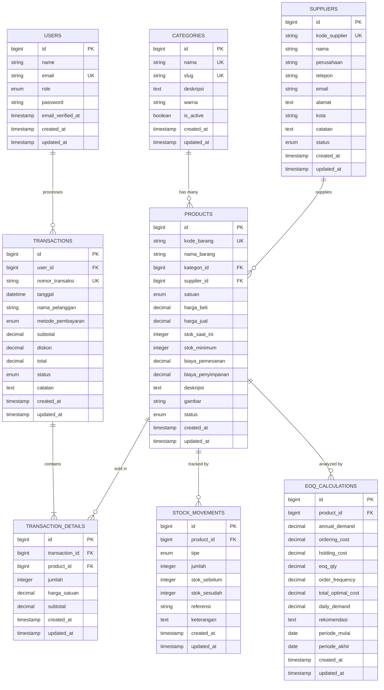

# DATABASE.md — Tanikuy Database Design

> **Engine:** MySQL 8.0+  
> **Charset:** utf8mb4  
> **Collation:** utf8mb4_unicode_ci  
> **Last Updated:** 2026-10-11

---

## 1. Entity Relationship Diagram



---

## 2. Table Specifications

### 2.1 `categories`

Kategori produk pertanian.

| Column | Type | Constraint | Default | Description |
|--------|------|-----------|---------|-------------|
| `id` | BIGINT UNSIGNED | PK, AUTO_INCREMENT | - | Primary key |
| `nama` | VARCHAR(100) | NOT NULL, UNIQUE | - | Nama kategori |
| `slug` | VARCHAR(100) | NOT NULL, UNIQUE | - | URL-friendly name |
| `deskripsi` | TEXT | NULLABLE | NULL | Deskripsi kategori |
| `warna` | VARCHAR(7) | NULLABLE | NULL | Hex color untuk badge (#RRGGBB) |
| `is_active` | BOOLEAN | NOT NULL | true | Status aktif |
| `created_at` | TIMESTAMP | NULLABLE | - | Laravel timestamp |
| `updated_at` | TIMESTAMP | NULLABLE | - | Laravel timestamp |

**Seed Data:**

| Nama | Slug | Warna |
|------|------|-------|
| Beras | beras | #F59E0B |
| Pupuk | pupuk | #10B981 |
| Benih | benih | #3B82F6 |
| Pestisida | pestisida | #EF4444 |
| Peralatan Pertanian | peralatan-pertanian | #8B5CF6 |
| Lainnya | lainnya | #6B7280 |

---

### 2.2 `suppliers`

Data pemasok/supplier.

| Column | Type | Constraint | Default | Description |
|--------|------|-----------|---------|-------------|
| `id` | BIGINT UNSIGNED | PK, AUTO_INCREMENT | - | Primary key |
| `kode_supplier` | VARCHAR(20) | NOT NULL, UNIQUE | - | Kode auto (SUP-XXXX) |
| `nama` | VARCHAR(150) | NOT NULL | - | Nama kontak person |
| `perusahaan` | VARCHAR(200) | NULLABLE | NULL | Nama perusahaan |
| `telepon` | VARCHAR(20) | NOT NULL | - | Nomor telepon |
| `email` | VARCHAR(100) | NULLABLE | NULL | Email |
| `alamat` | TEXT | NOT NULL | - | Alamat lengkap |
| `kota` | VARCHAR(100) | NOT NULL | - | Kota |
| `catatan` | TEXT | NULLABLE | NULL | Catatan internal |
| `status` | ENUM('active','inactive') | NOT NULL | 'active' | Status supplier |
| `created_at` | TIMESTAMP | NULLABLE | - | - |
| `updated_at` | TIMESTAMP | NULLABLE | - | - |

**Indexes:** `idx_suppliers_status`, `idx_suppliers_kota`

---

### 2.3 `products`

Master data produk.

| Column | Type | Constraint | Default | Description |
|--------|------|-----------|---------|-------------|
| `id` | BIGINT UNSIGNED | PK, AUTO_INCREMENT | - | Primary key |
| `kode_barang` | VARCHAR(20) | NOT NULL, UNIQUE | - | Kode auto (TK-XXXX) |
| `nama_barang` | VARCHAR(200) | NOT NULL | - | Nama produk |
| `kategori_id` | BIGINT UNSIGNED | FK → categories.id | - | Kategori produk |
| `supplier_id` | BIGINT UNSIGNED | FK → suppliers.id, NULLABLE | NULL | Supplier utama |
| `satuan` | ENUM('kg','pcs','liter','karung','botol','pack') | NOT NULL | - | Satuan ukur |
| `harga_beli` | DECIMAL(15,2) | NOT NULL | 0 | Harga beli per satuan |
| `harga_jual` | DECIMAL(15,2) | NOT NULL | 0 | Harga jual per satuan |
| `stok_saat_ini` | INT | NOT NULL | 0 | Stok saat ini |
| `stok_minimum` | INT | NOT NULL | 0 | Batas minimum stok |
| `biaya_pemesanan` | DECIMAL(15,2) | NOT NULL | 0 | Ordering cost (EOQ: S) |
| `biaya_penyimpanan` | DECIMAL(15,2) | NOT NULL | 0 | Holding cost per unit/tahun (EOQ: H) |
| `deskripsi` | TEXT | NULLABLE | NULL | Deskripsi produk |
| `gambar` | VARCHAR(255) | NULLABLE | NULL | Path file gambar |
| `status` | ENUM('active','inactive') | NOT NULL | 'active' | Status produk |
| `created_at` | TIMESTAMP | NULLABLE | - | - |
| `updated_at` | TIMESTAMP | NULLABLE | - | - |

**Indexes:** `idx_products_kategori`, `idx_products_supplier`, `idx_products_status`, `idx_products_nama_barang`

**Foreign Keys:**
- `kategori_id` → `categories(id)` ON DELETE RESTRICT
- `supplier_id` → `suppliers(id)` ON DELETE SET NULL

---

### 2.4 `transactions`

Header transaksi penjualan.

| Column | Type | Constraint | Default | Description |
|--------|------|-----------|---------|-------------|
| `id` | BIGINT UNSIGNED | PK, AUTO_INCREMENT | - | Primary key |
| `nomor_transaksi` | VARCHAR(30) | NOT NULL, UNIQUE | - | Nomor auto (INV-YYYYMMDD-XXXX) |
| `tanggal` | DATETIME | NOT NULL | - | Tanggal transaksi |
| `nama_pelanggan` | VARCHAR(150) | NULLABLE | NULL | Nama pembeli |
| `metode_pembayaran` | ENUM('cash','transfer','qris') | NOT NULL | 'cash' | Metode bayar |
| `subtotal` | DECIMAL(15,2) | NOT NULL | 0 | Subtotal sebelum diskon |
| `diskon` | DECIMAL(15,2) | NOT NULL | 0 | Total diskon |
| `total` | DECIMAL(15,2) | NOT NULL | 0 | Total setelah diskon |
| `status` | ENUM('completed','cancelled') | NOT NULL | 'completed' | Status |
| `catatan` | TEXT | NULLABLE | NULL | Catatan transaksi |
| `created_at` | TIMESTAMP | NULLABLE | - | - |
| `updated_at` | TIMESTAMP | NULLABLE | - | - |

**Indexes:** `idx_transactions_tanggal`, `idx_transactions_status`, `idx_transactions_metode`

---

### 2.5 `transaction_details`

Item-item dalam transaksi.

| Column | Type | Constraint | Default | Description |
|--------|------|-----------|---------|-------------|
| `id` | BIGINT UNSIGNED | PK, AUTO_INCREMENT | - | Primary key |
| `transaction_id` | BIGINT UNSIGNED | FK → transactions.id | - | Header transaksi |
| `product_id` | BIGINT UNSIGNED | FK → products.id | - | Produk yang dijual |
| `jumlah` | INT | NOT NULL | - | Quantity |
| `harga_satuan` | DECIMAL(15,2) | NOT NULL | - | Harga saat transaksi |
| `subtotal` | DECIMAL(15,2) | NOT NULL | - | jumlah × harga_satuan |
| `created_at` | TIMESTAMP | NULLABLE | - | - |
| `updated_at` | TIMESTAMP | NULLABLE | - | - |

**Foreign Keys:**
- `transaction_id` → `transactions(id)` ON DELETE CASCADE
- `product_id` → `products(id)` ON DELETE RESTRICT

**Indexes:** `idx_td_transaction`, `idx_td_product`

---

### 2.6 `stock_movements`

Log pergerakan stok (audit trail).

| Column | Type | Constraint | Default | Description |
|--------|------|-----------|---------|-------------|
| `id` | BIGINT UNSIGNED | PK, AUTO_INCREMENT | - | Primary key |
| `product_id` | BIGINT UNSIGNED | FK → products.id | - | Produk |
| `tipe` | ENUM('in','out','adjustment') | NOT NULL | - | Jenis pergerakan |
| `jumlah` | INT | NOT NULL | - | Jumlah unit (selalu positif) |
| `stok_sebelum` | INT | NOT NULL | - | Stok sebelum pergerakan |
| `stok_sesudah` | INT | NOT NULL | - | Stok sesudah pergerakan |
| `referensi` | VARCHAR(50) | NULLABLE | NULL | Nomor referensi (e.g., INV-xxx) |
| `keterangan` | TEXT | NULLABLE | NULL | Alasan/keterangan |
| `created_at` | TIMESTAMP | NULLABLE | - | - |
| `updated_at` | TIMESTAMP | NULLABLE | - | - |

**Foreign Keys:**
- `product_id` → `products(id)` ON DELETE CASCADE

**Indexes:** `idx_sm_product`, `idx_sm_tipe`, `idx_sm_created_at`

---

### 2.7 `eoq_calculations`

Riwayat kalkulasi EOQ per produk.

| Column | Type | Constraint | Default | Description |
|--------|------|-----------|---------|-------------|
| `id` | BIGINT UNSIGNED | PK, AUTO_INCREMENT | - | Primary key |
| `product_id` | BIGINT UNSIGNED | FK → products.id | - | Produk |
| `annual_demand` | DECIMAL(15,2) | NOT NULL | - | D: Permintaan tahunan |
| `ordering_cost` | DECIMAL(15,2) | NOT NULL | - | S: Biaya pemesanan |
| `holding_cost` | DECIMAL(15,2) | NOT NULL | - | H: Biaya penyimpanan |
| `eoq_qty` | DECIMAL(15,2) | NOT NULL | - | Hasil EOQ |
| `order_frequency` | DECIMAL(10,2) | NOT NULL | - | Frekuensi order/tahun |
| `total_optimal_cost` | DECIMAL(15,2) | NOT NULL | - | Total biaya optimal |
| `daily_demand` | DECIMAL(10,2) | NOT NULL | - | Demand harian |
| `rekomendasi` | TEXT | NULLABLE | NULL | Teks rekomendasi |
| `periode_mulai` | DATE | NOT NULL | - | Awal periode data |
| `periode_akhir` | DATE | NOT NULL | - | Akhir periode data |
| `created_at` | TIMESTAMP | NULLABLE | - | - |
| `updated_at` | TIMESTAMP | NULLABLE | - | - |

**Foreign Keys:**
- `product_id` → `products(id)` ON DELETE CASCADE

**Indexes:** `idx_eoq_product`, `idx_eoq_periode`

---

## 3. Key Queries Reference

### 3.1 EOQ Calculation — Annual Demand

```sql
-- Get annual demand for a product (extrapolated if < 12 months data)
SELECT
    p.id,
    p.nama_barang,
    COALESCE(SUM(td.jumlah), 0) as total_sold,
    DATEDIFF(MAX(t.tanggal), MIN(t.tanggal)) as days_span,
    CASE
        WHEN DATEDIFF(MAX(t.tanggal), MIN(t.tanggal)) > 0
        THEN (COALESCE(SUM(td.jumlah), 0) / DATEDIFF(MAX(t.tanggal), MIN(t.tanggal))) * 365
        ELSE 0
    END as annual_demand
FROM products p
LEFT JOIN transaction_details td ON td.product_id = p.id
LEFT JOIN transactions t ON t.id = td.transaction_id
    AND t.status = 'completed'
    AND t.tanggal >= DATE_SUB(CURDATE(), INTERVAL 12 MONTH)
WHERE p.id = ?
GROUP BY p.id, p.nama_barang;
```

### 3.2 Stock Alert — Products Below Minimum

```sql
SELECT
    p.*,
    c.nama as kategori_nama,
    s.nama as supplier_nama,
    CASE
        WHEN p.stok_saat_ini <= p.stok_minimum THEN 'critical'
        WHEN p.stok_saat_ini <= p.stok_minimum * 1.5 THEN 'warning'
        ELSE 'normal'
    END as stock_status
FROM products p
LEFT JOIN categories c ON c.id = p.kategori_id
LEFT JOIN suppliers s ON s.id = p.supplier_id
WHERE p.status = 'active'
    AND p.stok_saat_ini <= p.stok_minimum * 1.5
ORDER BY p.stok_saat_ini ASC;
```

### 3.3 Sales Report — Daily Summary

```sql
SELECT
    DATE(t.tanggal) as tanggal,
    COUNT(DISTINCT t.id) as jumlah_transaksi,
    SUM(t.total) as total_penjualan,
    SUM(td.jumlah) as total_item_terjual
FROM transactions t
JOIN transaction_details td ON td.transaction_id = t.id
WHERE t.status = 'completed'
    AND t.tanggal BETWEEN ? AND ?
GROUP BY DATE(t.tanggal)
ORDER BY tanggal DESC;
```

### 3.4 Top Selling Products

```sql
SELECT
    p.id,
    p.kode_barang,
    p.nama_barang,
    c.nama as kategori,
    SUM(td.jumlah) as total_qty,
    SUM(td.subtotal) as total_revenue,
    COUNT(DISTINCT td.transaction_id) as jumlah_transaksi
FROM products p
JOIN transaction_details td ON td.product_id = p.id
JOIN transactions t ON t.id = td.transaction_id
LEFT JOIN categories c ON c.id = p.kategori_id
WHERE t.status = 'completed'
    AND t.tanggal BETWEEN ? AND ?
GROUP BY p.id, p.kode_barang, p.nama_barang, c.nama
ORDER BY total_qty DESC
LIMIT 10;
```

### 3.5 Gross Profit Report

```sql
SELECT
    DATE_FORMAT(t.tanggal, '%Y-%m') as bulan,
    SUM(td.subtotal) as total_penjualan,
    SUM(td.jumlah * p.harga_beli) as total_hpp,
    SUM(td.subtotal) - SUM(td.jumlah * p.harga_beli) as laba_kotor,
    ROUND(
        ((SUM(td.subtotal) - SUM(td.jumlah * p.harga_beli)) / SUM(td.subtotal)) * 100,
        2
    ) as margin_persen
FROM transactions t
JOIN transaction_details td ON td.transaction_id = t.id
JOIN products p ON p.id = td.product_id
WHERE t.status = 'completed'
    AND t.tanggal BETWEEN ? AND ?
GROUP BY DATE_FORMAT(t.tanggal, '%Y-%m')
ORDER BY bulan;
```

---

## 4. Migration Naming Convention

```
YYYY_MM_DD_HHMMSS_create_{table}_table.php
YYYY_MM_DD_HHMMSS_add_{column}_to_{table}_table.php
YYYY_MM_DD_HHMMSS_modify_{column}_in_{table}_table.php
```

---

## 5. Data Integrity Rules

| Rule | Implementation |
|------|----------------|
| Produk tidak bisa dihapus jika pernah ada transaksi | ON DELETE RESTRICT pada `transaction_details.product_id` |
| Supplier tidak bisa dihapus, hanya di-set null | ON DELETE SET NULL pada `products.supplier_id` |
| Detail transaksi dihapus bersama header | ON DELETE CASCADE pada `transaction_details.transaction_id` |
| Stok tidak boleh negatif | CHECK constraint + validasi di `StockService` |
| Kategori tidak bisa dihapus jika ada produk | ON DELETE RESTRICT pada `products.kategori_id` |
| Nomor transaksi dan kode barang unik | UNIQUE constraint |
